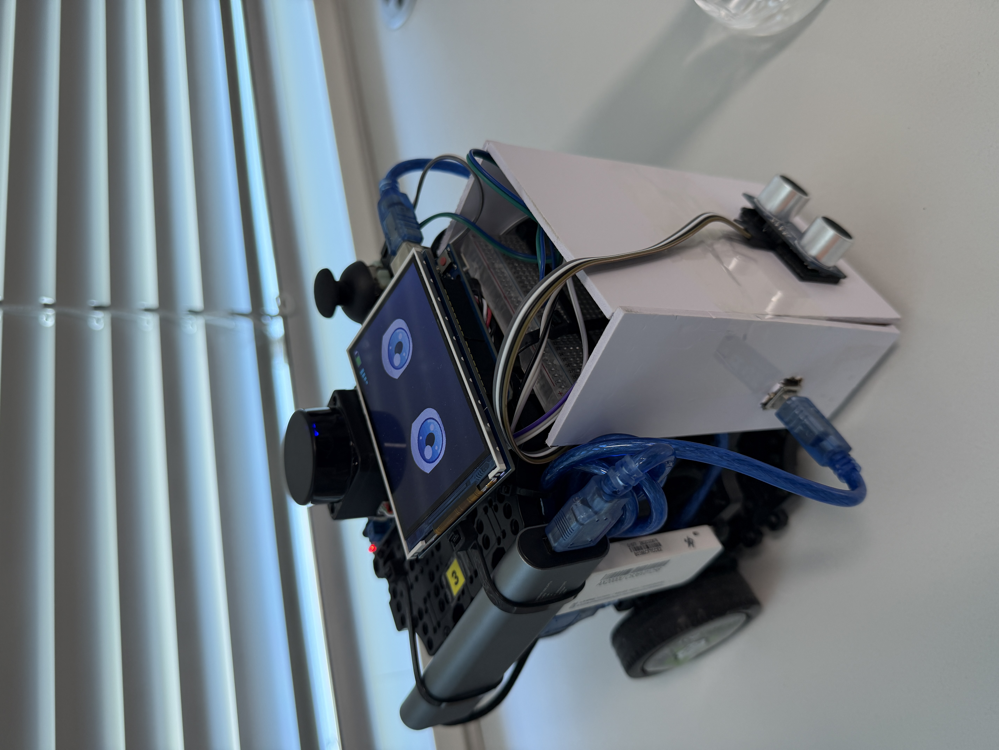
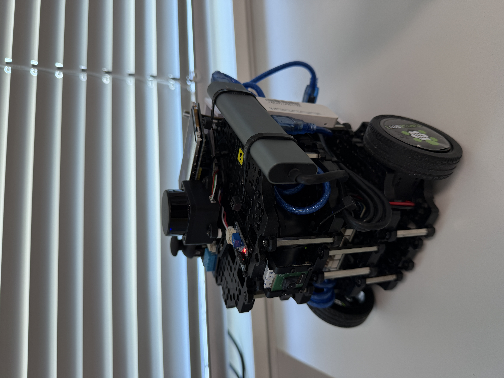
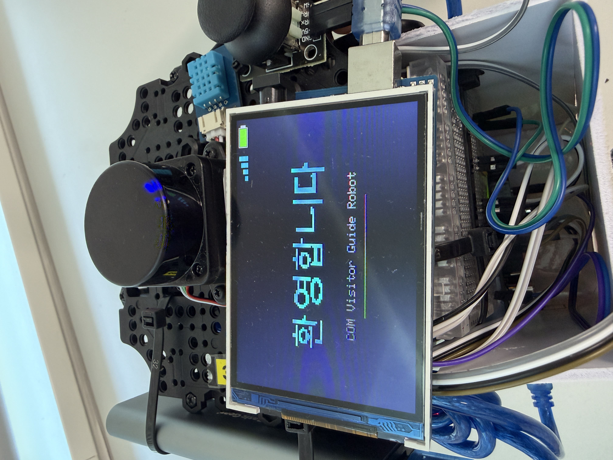
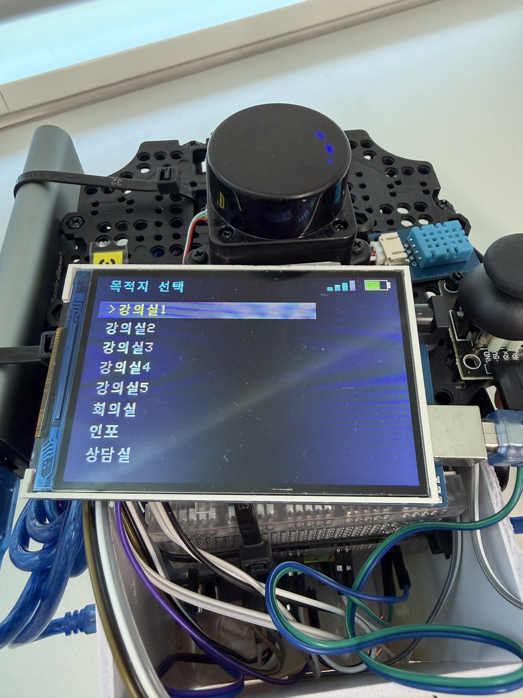
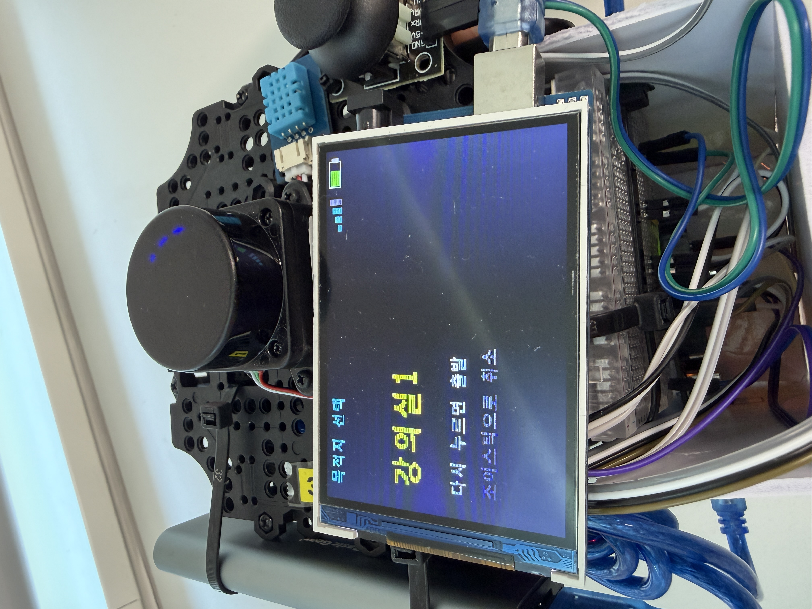
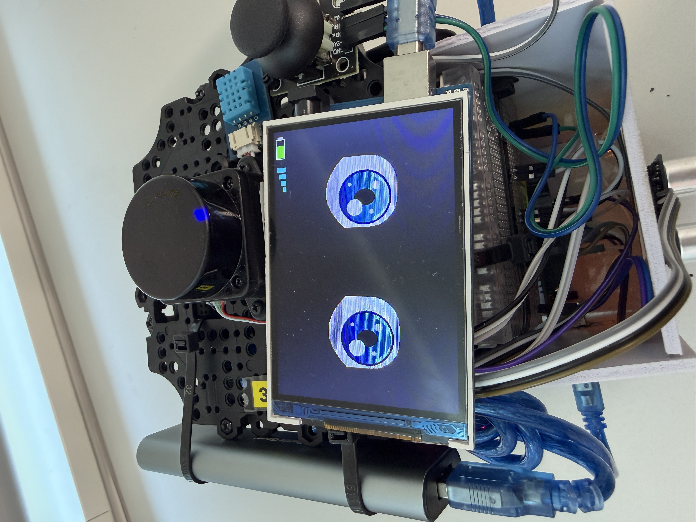
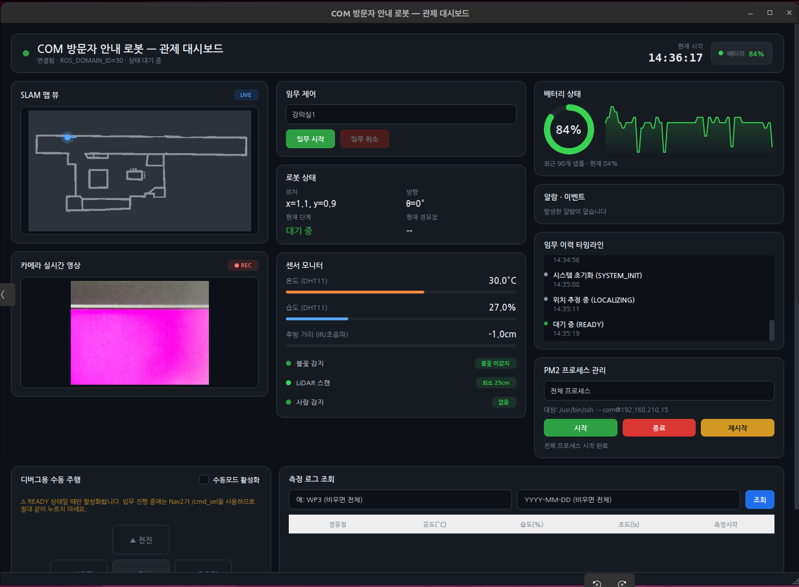
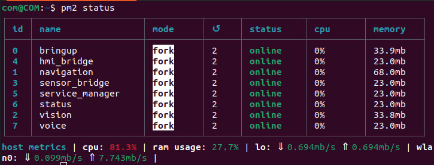

# COM 방문자 안내 로봇 (TurtleBot3 Burger)

**ROS 2 Humble · Nav2 · ArUco 정밀 도킹 기반 실내 자율주행 방문자 안내 로봇**

처음 방문한 실내 공간(강의실·복도)에서 방문자를 원하는 목적지까지 자율주행으로 안내하고,
이동 중 환경 상태(온도·습도·불꽃)를 점검하며, 임무를 마치면 **ArUco 마커 기반 정밀 도킹**으로
충전 스테이션에 스스로 복귀하는 로봇입니다. COM팀 졸업 프로젝트.

<p align="center">
  
  &nbsp;
  
</p>

---

## 🎉 시연 결과

**2026-08-21 졸업 프로젝트 시연에서 전체 임무 사이클이 실물로 완주됐습니다.**

- **자율주행 안내 → 목적지 도착 → 자동 복귀 → ArUco 마커(ID 29) 정밀 도킹**까지
  전 구간이 사람 개입 없이 한 번에 수행됐습니다.
  (`READY → UNDOCKING → GUIDING → ARRIVED → RETURNING → DOCKING → DOCKED → READY`)
- **정밀 도킹 성공** — 좁은 카메라 화각(수평 27°)과 좌우 정렬 수렴 문제를 해결한 도킹
  로직이 실제 충전 스테이션 정렬까지 도달했습니다.
- **안전 기능 검증** — 후방 장애물 감지 정지(`OBSTACLE_STOP`)와 사람 감지 정지
  (`PERSON_WAIT`)가 주행 중 실제로 동작하는 것을 확인했습니다.

| 항목 | 실측 |
|---|---|
| 목적지(강의실1)까지 자율주행 | 5.66 m / **77초** |
| 도착 위치 정밀도 | 오차 **3 mm** |
| 도킹 지점 자동 복귀 | **43초** |
| 전체 노드 상시 가동 | PM2로 8개 노드 `online` 안정 유지 |

---

## 🎬 데모 영상

시연 전체 과정(자율주행 안내 → 목적지 도착 → 자동 복귀 → ArUco 정밀 도킹, 약 2분)을
영상으로 담았습니다.

▶️ **[전체 데모 영상 보기](docs/Demo_Video/Play_Demo.mp4)** — GitHub에서 파일을 클릭하면
내장 플레이어로 바로 재생됩니다.

---

## 주요 기능

- **Nav2 자율주행 안내** — 지정 목적지 8곳(강의실1~5·회의실·인포·상담실)까지 경로 계획·주행
- **ArUco 정밀 도킹** — 임무 완료 후 충전 스테이션의 마커(ID 29)를 인식해 stop-and-look 방식으로 정렬·도킹
- **안전 정지** — 후방 초음파 장애물 감지, 카메라 기반 사람 감지 시 자동 정지·재개
- **HMI (탑승형 화면 + 조이스틱)** — 3.5" TFT 한글 UI로 목적지 선택, 상태별 표정/안내 표시
- **음성 안내** — 상태 전이(안내 시작·도착·복귀 등) 시 한국어 음성 재생
- **환경 센싱** — 이동 중 온도·습도·불꽃 감지
- **관제 대시보드(PyQt5)** — 맵·카메라·센서·배터리·임무 이력을 원격 모니터링, 임무 제어
- **자동 기동/복구** — 전원 인가 시 PM2가 8개 노드 자동 기동 + 노드별 최대 3회 자동 재시작

---

## 화면 · 인터페이스

### 로봇 탑재 TFT 화면 (한글 UI)

| 웰컴 | 목적지 선택 | 목적지 확인 | 주행 중 |
|:---:|:---:|:---:|:---:|
|  |  |  |  |
| 부팅 시 환영 화면 | 조이스틱으로 목적지 선택 | 한 번 더 누르면 출발 | 주행 상태 표정 |

### 관제 대시보드 (관제 PC 전용)

<p align="center"></p>

SLAM 맵 뷰, 카메라 실시간 영상, 임무 제어(`/start_mission`·`/cancel_mission`), 로봇 상태,
센서 모니터, 배터리 추이, 임무 이력 타임라인, 측정 로그 조회, PM2 프로세스 원격 제어를 제공합니다.
(목적지 선택은 로봇 탑재 TFT+조이스틱으로 수행하며, GUI는 관제/모니터링용입니다.)

### PM2 프로세스 (8개 노드 자동 기동)

<p align="center"></p>

---

## 서비스 상태머신

```
SYSTEM_INIT → LOCALIZING → READY → UNDOCKING → GUIDING → ARRIVED → RETURNING → DOCKING → DOCKED → READY
                                       │                    │
                                       └─(사람 감지)→ PERSON_WAIT
                              (장애물 감지)→ OBSTACLE_STOP
                              (재시도 초과 등)→ ERROR
```

- **UNDOCKING** — 임무 시작 직후 충전 스테이션에서 후진해 빠져나온 뒤 `GUIDING`으로 진입합니다.
- **ARRIVED** — 도착 후 `arrival_wait`(기본 5초, TFT 보드 타이머와 동일) 대기 후 `RETURNING`으로 자동 전이해 도킹 지점으로 복귀합니다.
- **DOCKED** — `docked_wait`(기본 2초) 후 `READY`로 복귀합니다.
- 배터리 임계값 이하이거나 이동에 반복 실패하면 어느 주행 상태에서든 `RETURNING`으로 전이합니다.

상세 로직: `com_service/com_service/service_manager_node.py`의 `MissionStateMachine` / `SafetyMonitor`.

---

## 하드웨어 구성

| 구성 요소 | 역할 | 비고 |
|---|---|---|
| TurtleBot3 Burger | 2륜 차동구동 베이스 (최대 0.22 m/s) | - |
| OpenCR 보드 | 모터 제어 + IMU (`turtlebot3_node`) | `/dev/opencr` |
| 2D LiDAR (COIN D4) | 장애물 감지 + AMCL 위치추정 | `/dev/tb3_lidar` |
| Raspberry Pi Camera (imx219) | ArUco 마커 인식·사람 감지 | CSI, 320×240 |
| 메인센서보드 (Arduino Uno) | DHT11(온습도)·불꽃·후방 초음파·조이스틱 | `/dev/com_sensorboard`, 9600 baud |
| TFT보드 (Arduino Uno) | 3.5" TFT 한글 UI 전담 (ILI9486) | `/dev/com_tftboard`, 115200 baud |
| Raspberry Pi 4 | 온보드 컴퓨터 | 전원 인가 시 PM2가 노드 자동 기동 |
| 충전 스테이션 | ArUco 마커(ID 29, 10×10 cm) 부착 | 정밀 도킹 대상 |
| 관제 PC | 관제 대시보드(`com_gui`) 실행, 개발/문서 | - |

> 시리얼 포트는 `com_launch/udev/99-com-robot-serial.rules`(시리얼 번호 기반 udev 규칙)로
> `/dev/com_sensorboard`·`/dev/com_tftboard` 심볼릭 링크에 고정돼 있어, 재부팅해도 `ttyACM`
> 번호 변동과 무관하게 항상 올바른 보드에 연결됩니다. 새 SD카드/파이로 옮기면 규칙을 다시
> 설치하세요: `sudo cp com_launch/udev/99-com-robot-serial.rules /etc/udev/rules.d/ && sudo udevadm control --reload-rules && sudo udevadm trigger`

---

## 소프트웨어 구성

| 구분 | 내용 |
|---|---|
| OS / 미들웨어 | Ubuntu 22.04 · ROS 2 Humble (Fast-DDS) |
| 내비게이션 | Nav2 (bt_navigator, planner, controller, amcl, map_server, costmap) — `nav2_params.yaml`로 Pi4에 맞게 튜닝 |
| SLAM | slam_toolbox (사전 지도 작성용) |
| 비전 | OpenCV ArUco (`DICT_4X4_50`) + HOG 사람 감지 |
| GUI | PyQt5 관제 대시보드 (관제 PC 전용) |
| 음성 | gTTS 사전 생성 wav를 `aplay`로 재생 |
| 프로세스 관리 | PM2 (`ecosystem.config.js`) — 8개 노드 자동 기동/재시작 |

---

## 패키지 구조

```
com_ws/src/
├── com_bringup/      # Nav2 기동 (navigation.launch.py, nav2_params.yaml)
├── com_navigation/   # waypoints.yaml, aruco_markers.yaml, maps/
├── com_interfaces/   # 커스텀 msg/srv (StartMission, RobotState, ArucoMarker, EnvData, TtsRequest 등)
├── com_sensors/      # 시리얼 브릿지 — serial_bridge_node(메인센서보드), hmi_bridge_node(TFT보드)
├── com_vision/       # 카메라 + aruco_node (마커 인식·도킹 오차 계산·사람 감지)
├── com_service/      # service_manager_node (상태머신·정밀 도킹), voice_node, auto_dock_node
├── com_status/       # status_node (배터리 %·상태·측정 로그 발행)
├── com_gui/          # PyQt5 관제 대시보드 (관제 PC 전용)
├── com_launch/       # robot_all.launch.py, PM2 ecosystem.config.js, udev 규칙
└── coin_d4_driver/   # LiDAR 드라이버 (서드파티)
```

---

## 빌드 & 실행

### 빌드

```bash
cd ~/com_ws
source /opt/ros/humble/setup.bash
colcon build --symlink-install
source install/setup.bash
```

### 실행 (운영 기본값: PM2 자동 기동)

로봇에 전원을 넣으면 PM2가 8개 노드(bringup·navigation·vision·sensor_bridge·hmi_bridge·
service_manager·status·voice)를 자동 기동합니다. 상태 확인:

```bash
pm2 list                 # 8개 전부 online 인지 확인
pm2 logs <노드이름>       # 특정 노드 로그
```

### 실행 (수동 통합 실행)

디버깅용으로 단일 launch로 띄울 수 있습니다. **PM2가 이미 떠 있으면 같이 띄우지 마세요**
(노드 중복으로 리소스·오디오 장치 경합):

```bash
ros2 launch com_launch robot_all.launch.py
```

### 관제 대시보드 (관제 PC에서)

```bash
ros2 run com_gui gui_node
```

### 임무 지시

로봇 TFT에서 조이스틱으로 목적지를 고르고 버튼을 두 번 누르면 출발합니다. 원격으로도 가능:

```bash
ros2 service call /start_mission com_interfaces/srv/StartMission "{destination_id: 'class1'}"
ros2 service call /cancel_mission std_srvs/srv/Trigger   # 임무 취소 → READY 복귀
```

---

## 목적지와 지도

- 지도: `com_navigation/maps/map.yaml` (SLAM으로 사전 작성)
- 웨이포인트: `com_navigation/config/waypoints.yaml`
- 도킹 마커: `DICT_4X4_50`, ID 29, 10×10 cm (목적지 도착 판정은 마커가 아닌 Nav2 좌표 기반)

**목적지 8곳**

| id | 표시 라벨 | x | y | yaw |
|---|---|---|---|---|
| `class1` | 강의실1 | 4.5604 | 0.5400 | 0.0 |
| `class2` | 강의실2 | 9.1789 | 0.6447 | 0.0 |
| `class3` | 강의실3 | 17.9021 | 0.5400 | 0.0 |
| `class4` | 강의실4 | 20.9246 | -0.8556 | 0.0 |
| `class5` | 강의실5 | 22.5940 | 0.4181 | 0.0 |
| `meeting` | 회의실 | 12.5646 | -3.6379 | 0.0 |
| `info` | 인포 | 2.9565 | -4.0722 | 0.0 |
| `office` | 상담실 | 12.7092 | -4.2376 | 0.0 |
| `docking` | 도킹 | 0.5327 | 0.0383 | 1.4982 (85.8°) |

> 목적지 라벨/id는 `waypoints.yaml`, `com_gui`, TFT 펌웨어 세 곳에 있으므로 id를 바꾸면 세 곳을
> 함께 수정하고 TFT 펌웨어를 재업로드해야 합니다. 로봇을 옮기면 `docking` 좌표(3개 파일에
> 중복)를 실제 시작 위치로 갱신하세요.

---

## 팀원 역할

| 김찬중 | 권오민 |
|---|---|
| 서류 7종 + 발표 PPT 작성 | HMI(TFT+조이스틱), 목적지 메뉴 UI |
| 환경 세팅, bringup + 카메라 캘리브레이션 | Nav2·SLAM 준비, 하드웨어 조립, 실공간 매핑 |
| voice 음성 안내 | aruco 마커 인식·정밀 도킹 오차 계산·사람 감지 |
| **service_manager** (상태머신·ArUco 정밀 도킹) | sensor_bridge, status(배터리·측정 로그·상태 발행) |

**공동**: `com_interfaces` 메시지 정의, 통합 테스트 및 시연.

---

## 정식 요구사항·설계 문서

제출용 정식 문서는 `docs/requirements/`에 있습니다 (URS·SRS·SAD·SDD·DDS·HMI·ICD 7종).
발표 자료는 `docs/presentation/COM_TurtleBot3_발표자료.pptx`입니다.

- 일정/역할: `docs/schedule/TurtleBot3_간트차트_일일역할.xlsx` (일일 역할 분담 간트차트)
- 데모 영상: `docs/Demo_Video/Play_Demo.mp4`

- 저장소: `unitydt-ros2-class2-2026/com_main_project_01`
- 팀: COM (김찬중, 권오민) · 로봇 실물: `192.168.210.15` (`ROS_DOMAIN_ID=30`)
